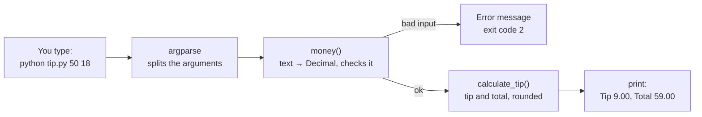

# Recap: tip calculator

## 1. What we built
A tiny command-line program, `tip.py`. You type a bill amount and a tip percent, and it prints the tip and the total, rounded to cents. Example: `python tip.py 50 18` prints `Tip: 9.00` and `Total: 59.00`.

## 2. How it works
**`money(text)`**: the input checker. Command-line arguments always arrive as text, so this turns `"50"` into a number. It rejects anything that isn't a valid, non-negative amount, so bad data never reaches the math.

**`calculate_tip(bill, percent)`**: the math, and nothing else. It works out `bill × percent / 100`, rounds to cents, and adds it to the bill. Because it doesn't print anything or read input itself, it's easy to reuse or test.

**`main()`**: the glue. It sets up `argparse` (Python's built-in tool for reading command-line arguments), hands each argument to `money()`, calls `calculate_tip()`, and prints the result.

## 3. Step by step
1. Checked the folder. It was empty apart from an unrelated empty `run1.txt`, and it isn't a git repository. Python 3.14 is installed.
2. Wrote `tip.py`. Chose `Decimal` over `float` so cents stay exact, and "round half up" so rounding matches receipts.
3. Ran `python tip.py 50 18` and got 9.00 / 59.00, which is correct.
4. Extra checks: `12.35 15` gives 1.85 / 14.20, which rounds correctly from 1.8525. `abc 15` gives a clear error with exit code 2. No problems found.

## 4. Diagram

## 5. Key ideas to remember
- **Floats aren't exact for money; Decimal is.** `0.1 + 0.2` is `0.30000000000000004` as floats, but `Decimal("0.1") + Decimal("0.2")` is exactly `0.3`.
- **Rounding rules differ.** `round(2.5)` is `2` (banker's rounding); `ROUND_HALF_UP` gives `3`.
- **Check input at the edge.** `money()` rejects `"abc"` before any math runs, so the rest of the code can trust its numbers.
- **One job per function.** `calculate_tip(Decimal("50"), Decimal("18"))` can be tested with no command line at all.
- **Exit codes talk to other programs.** `0` means success and non-zero means failure, so `python tip.py abc 15` exits with `2`.

## 6. What's next
- No automated tests yet. A small `test_tip.py` that calls `calculate_tip()` would lock in the rounding behaviour.
- No upper limit on the tip percent: `500` is accepted. That's probably fine, but it's worth deciding.
- Possible features: splitting the bill between people, or a currency symbol in the output.
- The folder isn't under git yet, so there's no history to roll back to.
